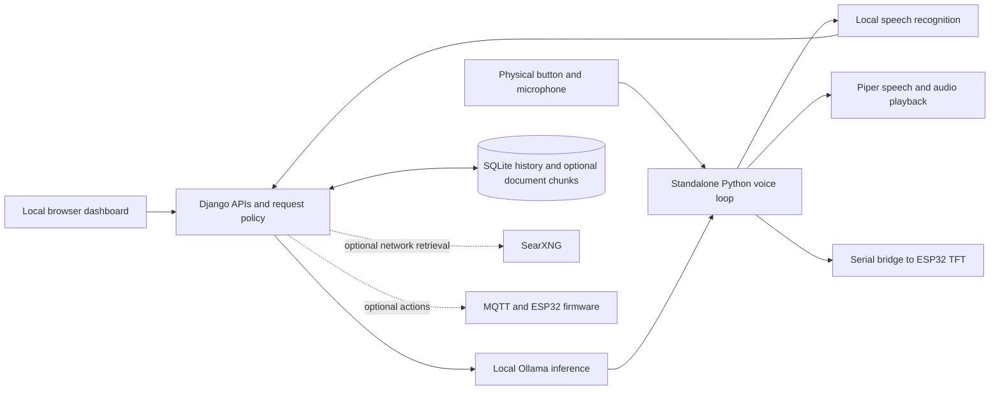
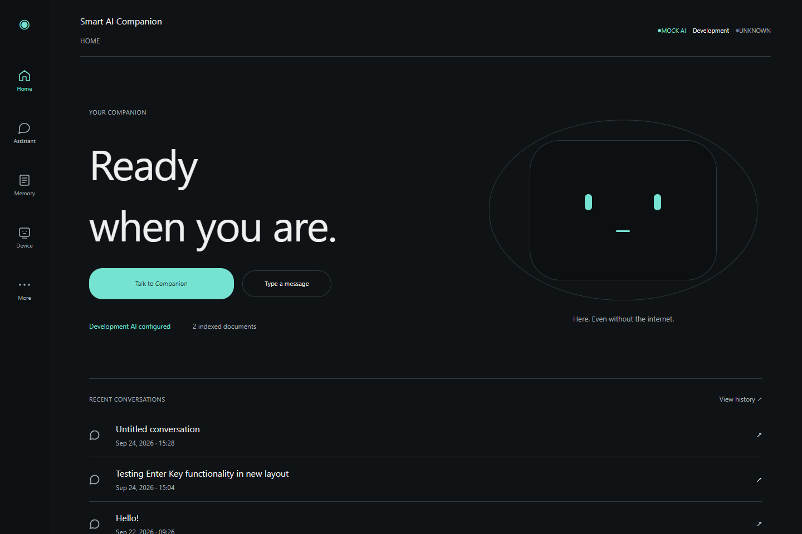
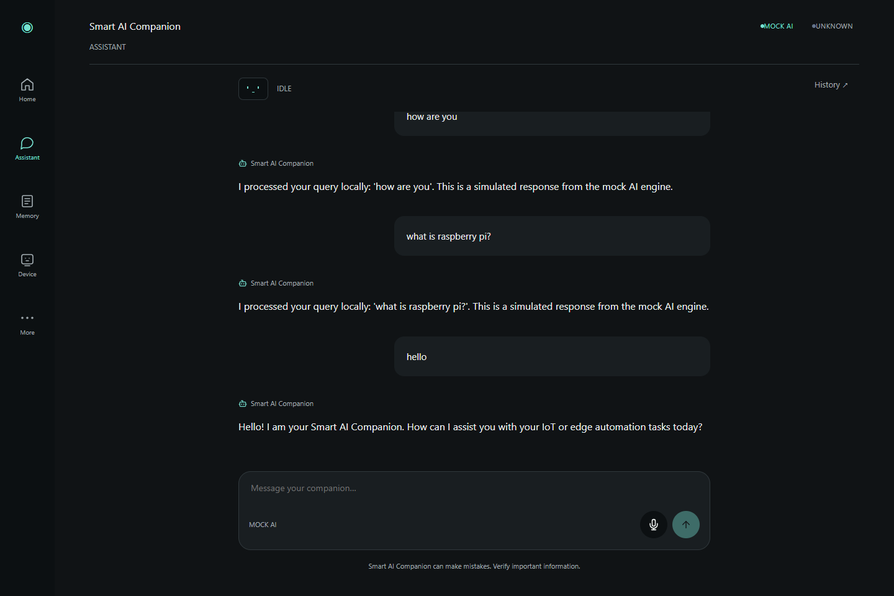

# Offline Based Smart AI Companion for Intelligent Edge Automation

An offline-first Raspberry Pi 5 companion combining local language-model inference,
physical voice interaction and a browser control dashboard in a custom 3D-printed
enclosure. Built as a completed academic project at **Malla Reddy University**,
**Computer Science and Engineering (IoT)**, academic year **2026–2027**.

The owner reports that the physical project was assembled, demonstrated, reviewed
and submitted. This public software baseline and its historical acceptance evidence
are available for inspection. The final Pi has additional release changes: see
[deployment provenance](docs/DEPLOYMENT.md) before treating GitHub main as a device backup.

## The problem

Cloud-dependent assistants need connectivity and can add remote-service dependencies
to basic interaction. This project explores running conversational inference and
speech tools on a small local computer, while keeping device state visible through
a physical display and a local web interface. It also provides an engineering platform
for studying resource limits, interrupted speech and hardware/software coordination.

## Implemented features and status

| Capability | Implementation and qualification |
|---|---|
| Local AI chat | Ollama backend, streaming API and a mock development backend. Owner-reported final model: `gemma4:e2b-it-q4_K_M`. Not executed during cleanup. |
| Physical voice | Standalone capture → STT → response → Piper playback pipeline with button interaction and interruption support; final response-control changes have separate release provenance. |
| TFT companion face | ESP32 serial bridge, state/text updates and audio-level animation. Firmware documentation records earlier owner acceptance; hardware was not retested here. |
| Browser control center | Chat, conversation history, document management, device/resource views, settings and network setup. Existing screenshot evidence records earlier UI states. |
| Conversation memory | SQLite history and bounded conversation-scoped lexical recall. |
| Local documents | Optional text/Markdown/text-layer PDF ingestion and lexical RAG; disabled for the owner-reported final demonstration. |
| Online information | Optional SearXNG retrieval; requires network access and explicit configuration. |
| IoT actions/sensing | MQTT controller and firmware are present; physical action/sensor installation and final-demo acceptance are not established by code alone. |
| Enclosure | Editable OpenSCAD, assembly/wiring/printing documents and manufacturing outputs for original and cost-optimized designs. |

Camera understanding, locomotion and reminders are future capabilities. A camera
mount in CAD is not a working vision pipeline. No benchmark or production-readiness
claim is made by this README.

## System architecture



The diagram describes responsibilities; the voice loop invokes shared Python
services rather than requiring a loopback HTTP chat request. See
[architecture](docs/ARCHITECTURE.md) for entry points and capability boundaries.

## Hardware components

The documented core uses Raspberry Pi 5 with 8 GB RAM, an ESP32 DevKit, MSP3520
3.5-inch ILI9488 SPI TFT, an I2S microphone, MAX98357A amplifier, speaker and a
momentary talk button. The enclosure holds the hardware and service wiring.
The [hardware guide](docs/HARDWARE.md) links the BOM, wiring, assembly, print
instructions and firmware setup. Optional reservations and future purchases in
the BOM must not be read as a confirmed installed-parts list.

## Technology stack

Python 3.10+, Django 5.2, Django REST Framework, SQLite, HTML/CSS/vanilla JavaScript,
Ollama, local STT tooling, Piper, pyserial, optional paho-mqtt and OpenSCAD.
The display firmware uses Arduino ESP32 and TFT_eSPI. `requirements.txt` records
Python dependencies; model weights, native speech executables, firmware libraries
and Linux packages are separate prerequisites. No Node build is needed to serve
the dashboard; browser-check utilities have their own tool requirements.

## How offline inference works

The local engine sends a bounded chat request to an Ollama instance running on
the device. Once the selected weights and native tools are installed, ordinary
local inference does not require an online provider. Configure the host as
loopback when the model should run on the same computer.

The owner confirms `gemma4:e2b-it-q4_K_M` for the final Pi demonstration. Public
baseline defaults and historical scripts still mention Qwen and earlier Llama
experiments. They document development history, not the final selected model;
set the explicit override in [setup](docs/SETUP.md). This cleanup changes neither
model-selection logic nor generation behavior.

RAG is a separate opt-in path: supported local files become lexical chunks in
SQLite, with relevant excerpts added to a request. It uses no embedding service
or vector database. Optional online retrieval is another distinct path and
requires Internet access. Offline inference alone is not a guarantee of encrypted
storage or universal local-only behavior in every possible configuration.

## Voice interaction pipeline

The physical entry point is `scripts/voice_loop.py`. Capture and speech recognition
produce text; shared assistant policy selects the response path; Ollama generates
text; Piper synthesizes speech for playback. Display updates expose listening,
thinking and speaking states. Tests cover interruption, capture readiness,
streaming and failure handling with simulated providers.

The later response-control release addresses physical interruption and output
launch behavior against a pinned Pi snapshot. Its deployment patch is not applied
to this public application root. Audible latency, microphone quality, thermal
behavior and button/TFT coordination still require physical acceptance on the
exact deployed version. Historical mock timing is not device performance.

## Hardware and IoT integration

Serial display communication and MQTT actions are independent integrations.
The display bridge uses a configured stable USB serial path; MQTT uses explicit
broker/device settings and acknowledgements. Failed transport must not be described
as a successful physical action. Keep integrations disabled on desktop development
machines. Follow the documented wiring and firmware setup rather than guessing
pins, changing SPI clocks or sharing hardware ownership between processes.

## Screenshots and demonstration

These are genuine retained repository screenshots from earlier UI acceptance work,
not freshly captured final-device certification.





For mobile and live-Pi layout evidence see [responsive acceptance](docs/LIVE_PI_RESPONSIVE_ACCEPTANCE.md).
The corresponding viewport matrices and traces remain in `docs/screenshots/responsive/`.
Only two representative images are embedded here to keep the presentation concise.

An approved photograph of the assembled companion and a public demonstration video
are still needed. CAD previews are not presented as hardware photographs. No demo
URL has been invented.

## Prerequisites

Use Python 3.10 or newer and a virtual environment. A desktop mock installation
needs no Pi, microphone, ESP32 or running model. Real inference needs Ollama and
installed model weights. Real voice needs native speech tools, audio devices and
models. Linux/Pi deployment also needs the reviewed system packages and permissions.
Read [setup](docs/SETUP.md) for Python/platform constraints, including openWakeWord.

## Installation and configuration

```sh
git clone https://github.com/Jagadish0216/smart-ai-companion.git
cd smart-ai-companion
python -m venv venv
```

Activate `venv` using `venv\Scripts\Activate.ps1` on PowerShell or
`source venv/bin/activate` on Linux. Install `python -m pip install -r requirements.txt`.
Copy `.env.example` to a private `.env`, generate a unique `SECRET_KEY`, and retain
mock AI/STT/TTS with optional hardware and retrieval disabled for development.
See [SETUP.md](docs/SETUP.md) for exact commands and the final-model override.

## Running the application

```sh
python manage.py migrate
python manage.py createsuperuser
python manage.py check
python manage.py runserver 127.0.0.1:8000
```

Open `http://127.0.0.1:8000/`. Mock replies verify the application path, not local
model quality. Set `AI_ENGINE=local` and the explicit Ollama model only when ready
to test actual inference. Staff login is needed for document writes.

## Running on Raspberry Pi

The owner-reported installation is `/home/jagadish/apps/smart-ai-companion` with
web, voice and Ollama services. Existing systemd templates use appliance-specific
paths. [Deployment](docs/DEPLOYMENT.md) explains the baseline, separate response-control
release, rollback and outstanding source synchronization. [First-boot setup](docs/first_boot_setup.md)
documents NetworkManager hotspot provisioning. Do not pull this cleanup into a
working Pi as an assumed source synchronization procedure.

For shared use, review `DEBUG=False`, a unique secret, allowed hosts and Django
deployment checks. Some dashboard/chat/history/control surfaces have public access;
this is not a hardened multi-user Internet service. Restrict access to a trusted
network or an authenticated proxy. Never commit `.env`, databases or Wi-Fi secrets.

## Testing

```sh
python manage.py test --noinput
python manage.py check
python manage.py makemigrations --check --dry-run
python scripts/repository_audit.py --output .audit-local
```

Use the intended virtual environment. The audit tool inventories tracked paths,
parses Python source and emits value-redacted security candidates for review.
It is not a complete secret-history or vulnerability scanner. See
[testing](docs/TESTING.md) and the [actual cleanup verification report](docs/REPOSITORY_CLEANUP_VERIFICATION.md)
for commands, failures, skips and unavailable hardware checks.

## Project directory structure

| Location | Purpose |
|---|---|
| `assistant/` | Inference, policy, voice, display, MQTT and regression tests |
| `conversations/`, `knowledge_base/` | History/memory and optional local knowledge |
| `dashboard/`, `system/`, `config/` | UI, device services and Django configuration |
| `templates/`, `static/` | Browser interface and assets |
| `firmware/`, `hardware/esp32/` | MQTT and display firmware |
| `hardware/enclosure/` | Editable CAD, print outputs and assembly evidence |
| `deployment/`, `scripts/` | Service templates and independent utilities |
| `docs/` | Setup, architecture, acceptance evidence and cleanup reports |

Detailed previous root documentation is preserved as a labeled
[historical engineering reference](docs/ENGINEERING_REFERENCE.md).

## Limitations

Main does not fully represent the last deployed Pi source or subsequent local
hotfix. RAG and online retrieval are optional; code presence does not verify
physical IoT acceptance. Model and speech assets must be acquired separately.
Lexical retrieval has relevance limits and does not read scanned PDFs. Linux
hardware behavior and acoustic performance cannot be certified by Windows mocks.
The repository has no project-wide license grant; obtain ownership/contributor
approval before adding one. Existing third-party notices remain intact.

## Future enhancements

Reconcile the final Pi snapshot with the public application root, publish approved
hardware media, repeat hardware acceptance against that pinned source, and review
shared-access authentication. Evaluate wake-word reliability, additional sensors
and camera understanding only through explicit implementation and testing.

## Contributors and acknowledgements

Academic context and completion status above are supplied by the project owner.
The canonical repository is [Jagadish0216/smart-ai-companion](https://github.com/Jagadish0216/smart-ai-companion).
Team names and faculty credits await verification; none have been invented.
Third-party tools retain their respective licenses, including the checked-in
[Lucide notice](static/vendor/lucide-LICENSE).

See the [release checklist](docs/PORTFOLIO_RELEASE_CHECKLIST.md) for media,
licensing, source synchronization and pull-request approval still needed.
